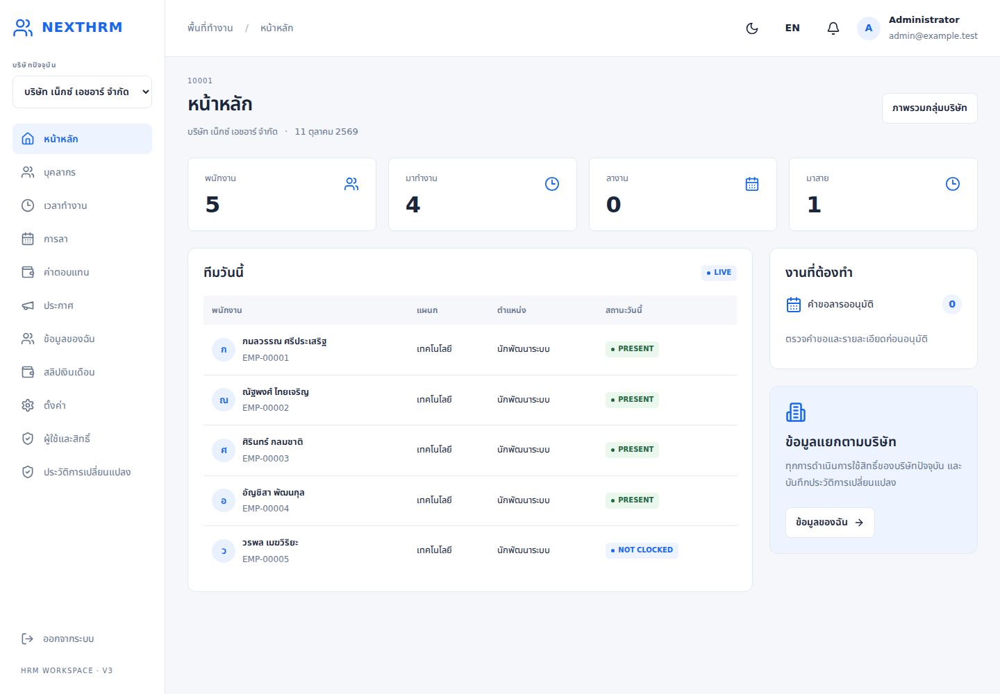

# NextHRM 1

ระบบ HRM หลายบริษัทจาก [HRM System Design](https://app.notion.com/p/HRM-System-Design-3f2f08f5233681c399a9e9ce593e500a) และ Version 3: **React 19 + Tailwind CSS 4 + Bun + Hono + SQLite** พร้อมหน้าจอภาษาไทย/อังกฤษและโหมดมืด

รองรับพื้นที่ทำงาน/บริษัท, บุคลากรและประวัติ, ตารางทำงาน/ลงเวลา/OT, คำขอลาและบัญชีวันลา, เงินเดือนและสลิป, ประกาศ/แจ้งเตือน WebSocket, สิทธิ์ตามบทบาทและขอบเขต, การย้าย/ทำงานหลายบริษัท, รายงานและ audit log

อ่าน [ขอบเขตและข้อจำกัด](docs/COVERAGE.md) ก่อนนำไปใช้จริง รุ่นนี้ยังมีรายการขั้นสูงของ spec ที่ไม่ครบ และต้องตรวจรับกฎ HR/เงินเดือนกับผู้ใช้งานจริง

## Deploy บน Railway

ใช้ branch `host/railway` และอ่าน [คู่มือตั้งค่า Railway](docs/RAILWAY.md) Dockerfile build React และรัน Bun/Hono ใน service เดียว ต้อง attach persistent volume สำหรับ SQLite/ไฟล์แนบ และกำหนด ENCRYPTION_KEY กับ public HTTPS origin รองรับตั้ง admin ครั้งแรกด้วย INITIAL_SETUP แบบไม่ reset เมื่อ redeploy

## ติดตั้ง

ต้องมี Bun 1.4.3+ และ Git; Node 22+ ใช้สำหรับ browser tests

```bash
git clone https://github.com/codercamera/nexthrm1.git
cd nexthrm1
bun install --frozen-lockfile
cp .env.example .env
openssl rand -hex 32
```

ใส่ค่าที่สร้างใน `ENCRYPTION_KEY` และตั้ง `SETUP_EMAIL`, `SETUP_PASSWORD` (อย่างน้อย 12 ตัวอักษร), `SETUP_WORKSPACE`, `SETUP_COMPANY` ใน `.env` จากนั้น:

```bash
bun run setup
bun run build
bun start
```

เปิด http://localhost:3000 เข้าสู่ระบบด้วยอีเมล/รหัสผ่านที่ตั้งไว้ และรหัส workspace ที่ได้จาก setup (`tenants.code`) ไม่มีบัญชี production เริ่มต้น ลบ `SETUP_PASSWORD` จากไฟล์หลังตั้งค่าแล้ว เก็บ encryption key แยกและสำรองอย่างปลอดภัย เพราะเปลี่ยนหรือลืม key จะอ่านข้อมูลที่เข้ารหัสไว้ไม่ได้

`bun run dev` build หน้าจอและ watch backend; เมื่อแก้ frontend ให้รัน build อีกครั้ง

## ทดสอบ

```bash
bun run verify
# TypeScript + Bun API/transport/accrual tests + production build
```

สำหรับการทดสอบ Chromium ใช้ฐานข้อมูลทิ้งได้ แยกจากข้อมูลจริง:

```bash
bunx playwright install chromium
DB_PATH=data/qa.sqlite SETUP_EMAIL=admin@example.test SETUP_PASSWORD=Your-test-password-123 bun run demo
TEST_PASSWORD=Your-test-password-123 TEST_START_SERVER=1 bun run test:browser
```

ต้องมี `ENCRYPTION_KEY` ใน `.env` สำหรับ demo และ server และให้ `TEST_DB_PATH` ตรงกับฐานข้อมูล demo หากเปลี่ยน path; browser test รับค่าตัวแปรผ่าน environment ของ Node ไม่โหลด `.env` อัตโนมัติ จึง export `ENCRYPTION_KEY` ก่อนรัน (`bun --env-file=.env run test:browser` ใช้โหลด environment ได้) คำสั่ง demo ปฏิเสธ production และไม่รันอัตโนมัติ

ผลทดสอบและภาพหน้าจออยู่ใน [TEST_REPORT](docs/TEST_REPORT.md) และ workflow CI อยู่ใน `.github/workflows/ci.yml`

## Seed ข้อมูลทดสอบครบโมดูล

```bash
# ตั้ง ENCRYPTION_KEY ใน .env ก่อน และใช้ฐานข้อมูลทดสอบแยก
SEED_PASSWORD='Your-seed-password-123' bun run db:seed
bun run start:seed
```

Login ด้วย workspace **`seed`**; ทุกบัญชีใช้รหัสผ่านที่กำหนดใน `SEED_PASSWORD`

| บัญชี | บทบาท |
|---|---|
| `admin@example.test` | ผู้ดูแล workspace และสองบริษัท |
| `hr@example.test` | HR / จัดเตรียมเงินเดือนทั้งสองบริษัท |
| `reviewer@example.test` | ผู้ตรวจเงินเดือน |
| `approver@example.test` | ผู้อนุมัติเงินเดือน |
| `employee1@example.test`, `employee7@example.test` | หัวหน้าแผนกและพนักงาน บริษัท 1/2 |
| `employee2@example.test`–`employee6@example.test` | พนักงานบริษัท 1 |
| `employee8@example.test`–`employee12@example.test` | พนักงานบริษัท 2 |

สร้าง 2 บริษัท, พนักงาน active 12 รายและ draft 2 ราย, สาขา/แผนก/ตำแหน่ง/ระดับ, schedule/วันหยุด, ประวัติการจ้าง/ค่าตอบแทน/ประสบการณ์, บัญชีธนาคารเข้ารหัส, attendance งวดก่อนและเดือนปัจจุบัน (รวม late/incomplete), leave approved/pending/rejected, OT approved/pending, เงินเดือนงวดก่อน approved พร้อม 12 สลิปและงวดปัจจุบัน draft, ประกาศ published/draft/scheduled/group พร้อมตัวอย่างอ่าน/รับทราบและ notification

ข้อมูลทั้งหมดสมมติ อัตราภาษี/ประกันสังคมเป็น test fixtures ไม่ใช่อัตรากฎหมายปัจจุบัน Payroll สร้างผ่าน API จริงโดยผู้จัดเตรียม/ผู้ตรวจ/ผู้อนุมัติคนละบัญชี

`db:seed` ใช้ `SEED_DB_PATH` (ค่าเริ่มต้น `data/seed.sqlite`) แยกจาก `DB_PATH`; ปฏิเสธฐานข้อมูลที่มีข้อมูลอื่นและ production สร้างใน staging file ก่อนเผยแพร่ไฟล์เมื่อสำเร็จ รันซ้ำบน seed เดิมเป็น no-op ไม่ reset password/ข้อมูลที่แก้ภายหลัง ถ้าเปลี่ยน password หรือ encryption key ให้สร้าง seed ใน path ใหม่ วันที่เริ่มต้นเป็นวันปัจจุบัน Asia/Bangkok หรือกำหนด `SEED_DATE=YYYY-MM-DD` สำหรับ snapshot ทดสอบ

`bun run demo` เดิมยังใช้ชุด 5 พนักงานสำหรับ browser smoke test และไม่ได้เปลี่ยนให้ใช้ seed นี้

## แก้ปัญหา login

สำหรับบัญชีจาก seed ให้รัน `bun run start:seed` ซึ่งเลือก `SEED_DB_PATH` โดยตรง แม้ `.env` จะตั้ง `DB_PATH=data/hrm.sqlite` อยู่ หากใช้ `bun start` ธรรมดาต้องตั้ง `DB_PATH` ให้ตรงกับฐานข้อมูลที่สร้างบัญชีไว้

- Seed: workspace `seed`, admin `admin@example.test`, password คือ `SEED_PASSWORD` **ตอนสร้าง seed ครั้งแรก** เปลี่ยนค่าใน `.env` หรือรัน seed ซ้ำไม่เปลี่ยนรหัสผ่านในฐานข้อมูล
- Demo: workspace `demo`, password คือ `SETUP_PASSWORD` ตอนสร้าง demo
- Setup: workspace คือ `tenants.code` ที่คำสั่ง setup แสดง ไม่ใช่ชื่อบริษัทหรือชื่อ workspace
- ผิด 5 ครั้งจะล็อก 15 นาที การลองระหว่างถูกล็อกจะไม่ต่อเวลาล็อก รอจน `locked_until` หมดหรือให้ tenant admin อื่นปลดล็อกใน Users

ตรวจฐานข้อมูล/รหัส workspace/สถานะบัญชีด้วย `bun run db:status` คำสั่งนี้อ่านอย่างเดียว ไม่สร้างฐานข้อมูลและไม่แสดง password hash/token/key ตรวจ seed โดยตรงได้ด้วย `DB_PATH=data/seed.sqlite bun run db:status` (ปรับ path หากใช้ `SEED_DB_PATH` อื่น)

## โครงสร้าง

- `src/client`: React, reusable dialogs/forms/tables, mobile navigation, employee print report
- `src/server`: Hono APIs, authentication/scopes, employees, time/leave, payroll, announcements, administration
- `migrations`: schema จาก spec 67 ตาราง + support tables/indexes/triggers
- `scripts`: setup, demo, migrations, backup/restore
- `tests`: API/regression, real HTTP/WebSocket/file transport, Chromium browser checks
- `docs/SPEC.md`, `docs/SPEC-V3.md`: ข้อกำหนดที่ใช้พัฒนา

API ทุกบริษัทเริ่มด้วย `/api/c/:companyId/`; server ตรวจ tenant, active company access, permissions และ employee scope ไม่อาศัยการซ่อนเมนูบน frontend เงินเก็บเป็น integer satang และเวลาการลาคิดเป็นนาที

## ใช้งานและสำรองข้อมูล

สร้าง master data และกำหนด schedule ให้พนักงานก่อนทำ attendance/payroll ตั้งค่าภาษี/ประกันสังคมพร้อมแหล่งอ้างอิงและผู้ตรวจสอบใน settings ก่อนคำนวณเงินเดือน ผู้จัดเตรียม ผู้ตรวจ และผู้อนุมัติต้องเป็นคนละคน ตรวจบัญชีธนาคารและข้อมูลภาษีของพนักงานก่อนอนุมัติ

```bash
bun run db:migrate
bun run db:backup
# หยุด server ก่อน restore; target ต้องเป็น path ใหม่
DB_PATH=data/restored.sqlite bun run db:restore backups/<backup-file>.sqlite
```

backup ใช้ SQLite `VACUUM INTO`, restore ตรวจ integrity/foreign keys และไม่เขียนทับฐานข้อมูลเดิม ต้องสำรอง `data/files` (ไฟล์แนบ) และ encryption key เพิ่มด้วย

Production: ใช้ HTTPS reverse proxy, ตั้ง `NODE_ENV=production`, `APP_ORIGIN` เป็น origin จริง, ใช้ volume ถาวรสำหรับฐานข้อมูลและไฟล์แนบ และเก็บ secret นอก Git ระบบใช้ cookie HTTPOnly/SameSite, Argon2id, AES-256-GCM, audit log ที่ห้ามแก้/ลบ และไฟล์แนบที่ตรวจสิทธิ์ก่อนดาวน์โหลด SQLite เหมาะกับ single-instance ในรุ่นนี้

## ภาพหน้าจอ



ภาพ [บุคลากรบนมือถือ](docs/qa/employees-mobile.png)
